# ⚡ Awesome Real-Time Customer Intent Signals 🎯

> 🚀 **A curated directory of top Real-Time Customer Intent Signal platforms, B2B buyer intelligence software, reverse-IP de-anonymization services, and open-source lead scoring engines.**  
> Uncover active buyer research across the dark funnel, detect high-intent accounts in real time, and prioritize sales pipeline conversions.
>
> ⭐ **Star this repository if you find it valuable!** ⭐

---

## 📑 Table of Contents

- [🌐 Sector Overview & Market Dynamics](#-sector-overview--market-dynamics)
- [🏢 SaaS & Hosted Commercial Platforms](#-saas--hosted-commercial-platforms)
  - [📊 SaaS Platforms Comparison & Pricing Matrix](#-saas-platforms-comparison--pricing-matrix)
  - [🔍 Detailed SaaS Profiles](#-detailed-saas-profiles)
- [💻 Open-Source Software & Toolkits](#-open-source-software--toolkits)
  - [⭐ Open-Source Leaderboard (Ranked by Stars)](#-open-source-leaderboard-ranked-by-stars)
  - [🛠️ Detailed Open-Source Profiles](#-detailed-open-source-profiles)
- [⚖️ Architecture & Data Source Comparison](#-architecture--data-source-comparison)
- [💖 Support & Community](#-support--community)
- [📈 Star History](#-star-history)
- [🤝 Contributing](#-contributing)
- [📄 License](#-license)

---

## 🌐 Sector Overview & Market Dynamics

The global B2B Intent Data & Buyer Intelligence market is valued between **$3.8 billion and $4.5 billion** and is projected to surpass **$11 billion to $18+ billion by the mid-2030s**, growing at a rapid CAGR of **12.8% – 16.6%** as revenue teams pivot from cold outbound to signal-led go-to-market motions.

The sector is **moderately to highly fragmented**: while a handful of well-capitalized enterprise conglomerates (6sense, ZoomInfo, Demandbase, Informa/TechTarget) dominate end-to-end account orchestration and commercial publisher co-ops, intense competition persists from agile pure-play reverse-IP de-anonymization vendors, product-review networks (G2, TrustRadius), and emerging self-hosted AI scoring engines.

---

## 🏢 SaaS & Hosted Commercial Platforms

Commercial cloud platforms providing third-party content consumption signals, first-party website visitor de-anonymization, and AI buying-stage predictions.

### 📊 SaaS Platforms Comparison & Pricing Matrix

*Sorted in descending order by enterprise company size (Valuation / Market Capitalization / Parent Enterprise Valuation).*

| 🏢 Platform | 💰 Company Size (Valuation / Market Cap / Revenue) | 🏷️ Starting Tier Pricing | 🎁 Free Tier Limit / Free Trial Plan Details | 🎯 Key Focus & Capability |
| :--- | :--- | :--- | :--- | :--- |
| **TechTarget Priority Engine** | **~$11.5B Market Cap** *(Parent Informa PLC; $300M+ revenue division)* | **$30,000 / year** *(Median ~$95,000/yr on Vendr; custom-quoted)* | **No free tier & no public free trial** *(Private scheduled live pilot/demo with sales rep only)* | 🎯 Permissioned 1st-party IT buyer intent from editorial network |
| **6sense** | **$5.2B Valuation** *(Post-money valuation; $426M+ funding)* | **$11,000 – $40,000 / year** *(Median ~$62,000/yr on Vendr; multi-year commitments)* | **No free tier & no self-serve trial** *(Free tier discontinued; POC/live sandbox only through sales scoping)* | 🤖 Enterprise Revenue AI, predictive buying stage & account intent |
| **Demandbase** | **$1.3B Valuation** *(~$200M+ ARR; $320M total funding)* | **$45,000 / year** *(Demandbase One base tier; median ~$70,000/yr on Vendr)* | **No free tier & no self-serve trial** *(Requires guided sales demo and custom proof-of-concept scoping)* | 📈 Unified ABM, B2B intent, advertising & sales intelligence |
| **ZoomInfo Intent** | **~$1.0B Market Cap** *(NASDAQ: GTM; ~$1.25B annual revenue)* | **$15,000 / year** *(Professional Plus base; Intent enabled on Advanced tiers $25,000+/yr)* | **7-day free trial** *(Usage capped; limits export credits, no CC required) & **Lite Plan** (10 contact export credits/mo)* | 👥 B2B contact intelligence combined with streaming intent topics |
| **Bombora** | **~$588M Valuation** *(~$56M annual revenue; GetLatka benchmark)* | **$25,000 / year** *(Base Company Surge®; onboarding fees $5,000–$20,000)* | **No free tier & no self-serve trial** *(Annual/multi-year enterprise contract only; sales-guided demo)* | 🌐 B2B intent cooperative covering 5,000+ business topics |
| **Clearbit Reveal** | **$150M Acquisition Valuation** *(Acquired by HubSpot NYSE: HUBS)* | **$200 / month** *(Legacy standalone; currently folded into HubSpot Breeze from $50/mo)* | **HubSpot free CRM tier available** *(Clearbit free tools sunset; Breeze enrichment requires paid HubSpot credits)* | 🕵️ Real-time IP-to-company de-anonymization and technographics |
| **Leadfeeder (Dealfront)** | **~$10M–$41M ARR** *(Private PE-backed; €30M growth facility)* | **€79 / month** *(Discover tier billed annually; €113 billed monthly)* | **Lite Plan: 100% Free Forever** *(Up to 100 identified companies/month, last 7 days data history, 20 contact credits)* | 🔍 Website visitor identification and company-level journey tracking |

---

### 🔍 Detailed SaaS Profiles

#### 🎯 [TechTarget Priority Engine](https://www.techtarget.com/priority-engine/)
- **Specialty:** Permissioned purchase intent derived directly from editorial tech content.
- **How it Works:** Tracks verified technology buyers reading whitepapers, vendor comparisons, and technical articles across TechTarget’s 150+ enterprise IT websites.
- **Enterprise Profile:** Operating under Informa PLC (LSE: INF, ~$11.5B market capitalization), delivering person-level opt-in intent data.

#### 🤖 [6sense](https://6sense.com/)
- **Specialty:** Account-based intent signals and predictive buying-stage modeling.
- **How it Works:** Ingests billions of external intent events, web visits, and CRM touchpoints to categorize target accounts into 4 dynamic buying journey stages (*Unaware*, *Aware*, *Considering*, *Deciding*).
- **Enterprise Profile:** Privately valued at $5.2B with over $426M in institutional venture backing.

#### 📈 [Demandbase](https://www.demandbase.com/)
- **Specialty:** Comprehensive Account-Based Marketing (ABM) orchestration with embedded intent.
- **How it Works:** Unifies third-party intent datasets with ad execution, account scoring, and sales engagement workflows to target buying committees.
- **Enterprise Profile:** Privately valued at $1.3B with over $200M in annual recurring revenue.

#### 👥 [ZoomInfo Intent](https://www.zoominfo.com/features/intent)
- **Specialty:** B2B contact and company database tied to digital topic surges.
- **How it Works:** Monitors content consumption spikes across business IPs and automatically matches them to key decision-maker emails, phone numbers, and organizational charts.
- **Enterprise Profile:** Publicly traded company (NASDAQ: GTM) generating ~$1.25B in annual revenue with an enterprise value exceeding $2.3B.

#### 🌐 [Bombora Company Surge®](https://bombora.com/)
- **Specialty:** The industry-standard B2B publisher intent data cooperative.
- **How it Works:** Aggregates content engagement metrics from 5,000+ business and media websites, calculating standard-deviation consumption surges against baseline activity.
- **Enterprise Profile:** Leading private data cooperative generating ~$56M in annual revenue with an estimated valuation of ~$588M.

#### 🕵️ [Clearbit Reveal (HubSpot Breeze)](https://clearbit.com/platform/reveal)
- **Specialty:** Live IP de-anonymization and visitor firmographic enrichment.
- **How it Works:** Converts anonymous website visitor IP addresses into verified company domain names, employee ranges, tech stacks, and industries in under 100 milliseconds.
- **Enterprise Profile:** Acquired by HubSpot (NYSE: HUBS) for $150M in 2023 and integrated into HubSpot Breeze Intelligence.

#### 🔍 [Leadfeeder (Dealfront)](https://www.dealfront.com/leadfeeder/)
- **Specialty:** Transparent B2B website visitor tracking with an accessible entry tier.
- **How it Works:** Identifies companies visiting your web properties via script tag, listing specific pages viewed, referral sources, and browse duration.
- **Enterprise Profile:** Scaled European B2B leader backed by institutional growth capital (€30M credit facility), with estimated revenues between $10M–$41M.

---

## 💻 Open-Source Software & Toolkits

Self-hosted, transparent, and privacy-conscious tools for lead scoring, visitor tracking, intent classification, and buying-signal intelligence.

### ⭐ Open-Source Leaderboard (Ranked by Stars)

| 💻 Repository | ⭐ GitHub Stars Badge | 🛠️ Tech Stack | 📜 License | 🎯 Primary Category |
| :--- | :--- | :--- | :--- | :--- |
| **[egoist/tinytraffic](https://github.com/egoist/tinytraffic)** |  | Go / DuckDB / ClickHouse | Open Source | 🌐 1st-Party Visitor Analytics & Event Tracking |
| **[daddydrac/Machine-Learning-For-Predictive-Lead-Scoring](https://github.com/daddydrac/Machine-Learning-For-Predictive-Lead-Scoring)** |  | Python / Scikit-Learn | MIT | 🧠 ML Predictive Lead Conversion Engine |
| **[mukulsinghal001/lead-scoring-model-python](https://github.com/mukulsinghal001/lead-scoring-model-python)** |  | Python / Pandas / Statsmodels | Open Source | 📊 Statistical Lead Scoring & Funnel Modeling |
| **[Othmane-Khadri/gtm-engineer-playbook](https://github.com/Othmane-Khadri/gtm-engineer-playbook)** |  | Markdown / CLI / Claude Code | MIT | 🧭 Signal Scanning, ICP Scoring & Battlecards |
| **[Astoriel/LeadGenius](https://github.com/Astoriel/LeadGenius)** |  | Python / Docker / YAML | MIT | ⚡ Self-Hosted Lead Scoring & Enrichment Engine |
| **[getcargohq/cargo-skills](https://github.com/getcargohq/cargo-skills)** |  | TypeScript / Cargo CLI | MIT | 📡 Buying-Signal Monitoring & Lead Routing |
| **[dancolta/trustpilot-outreach-automation](https://github.com/dancolta/trustpilot-outreach-automation)** |  | Node.js / Puppeteer / AI | MIT | 💬 Public Review Intent & Churn-Signal Outreach |
| **[loootai/looot-crm](https://github.com/loootai/looot-crm)** |  | Next.js / Supabase / Postgres | Open Source | 🗃️ Open-Source CRM with Live Intent Signals |
| **[loootai/looot-intent](https://github.com/loootai/looot-intent)** |  | TypeScript / Next.js / CLI | MIT | 🎯 Open-Source 6sense Buying-Stage Alternative |
| **[Nikkk2312/ai-lead-scoring-engine](https://github.com/Nikkk2312/ai-lead-scoring-engine)** |  | Python / FastAPI / SQLite / Docker | Open Source | 🤖 136-Feature Tri-Dimensional Intent Scorer |

---

### 🛠️ Detailed Open-Source Profiles

#### 🌐 [tinytraffic](https://github.com/egoist/tinytraffic) 
- **Stack:** Go / DuckDB / ClickHouse | **License:** Open Source
- **Overview:** A self-hosted, lightweight web analytics engine packaged into a single binary. Captures essential first-party intent signals (page views, session duration, custom conversion events, and outbound link clicks) without third-party tracking scripts or cookies.
- **Best for:** Development teams needing high-performance, private 1st-party event telemetry to feed internal intent pipelines.

#### 🧠 [Machine-Learning-For-Predictive-Lead-Scoring](https://github.com/daddydrac/Machine-Learning-For-Predictive-Lead-Scoring) 
- **Stack:** Python / Scikit-Learn / Pandas | **License:** MIT
- **Overview:** An end-to-end predictive machine learning architecture designed to identify high-converting prospects from behavioral, demographic, and engagement signals.
- **Best for:** Data scientists looking for proven feature-engineering workflows to train custom lead conversion models.

#### 📊 [lead-scoring-model-python](https://github.com/mukulsinghal001/lead-scoring-model-python) 
- **Stack:** Python / Jupyter / Logistic Regression | **License:** Open Source
- **Overview:** A well-documented statistical lead scoring case study using supervised machine learning and logistic regression to assign probability scores and eliminate low-intent inbound noise.
- **Best for:** Revenue operations and growth teams seeking an interpretable, transparent conversion probability baseline.

#### 🧭 [gtm-engineer-playbook](https://github.com/Othmane-Khadri/gtm-engineer-playbook) 
- **Stack:** Markdown / Claude Code CLI / Agent Workflows | **License:** MIT
- **Overview:** A comprehensive suite of 10 installable GTM agent skills turning developer terminals into sales command centers—covering ICP discovery, buying-signal scanning, lead scoring, and automated battlecards.
- **Best for:** Technical founders and GTM engineers executing signal-led outreach from local AI coding environments.

#### ⚡ [LeadGenius](https://github.com/Astoriel/LeadGenius) 
- **Stack:** Python / Docker / YAML | **License:** MIT
- **Overview:** An open-source, self-hosted alternative to Clearbit and MadKudu operating at $0/month. Features waterfall data enrichment, deterministic YAML-configured lead scoring, and automated webhook routing to HubSpot and Slack.
- **Best for:** Startups wanting predictable, rule-based qualification pipelines without recurring vendor seat taxes.

#### 📡 [cargo-skills](https://github.com/getcargohq/cargo-skills) 
- **Stack:** TypeScript / Node.js / Cargo CLI | **License:** MIT
- **Overview:** Autonomous GTM engineering skills enabling AI coding agents to build lead lists, verify contact data, score leads, and continuously monitor buying signals (job changes, funding announcements, tech stack adoption).
- **Best for:** AI agent builders and modern RevOps engineers automating signal monitoring across 130+ integrations.

#### 💬 [trustpilot-outreach-automation](https://github.com/dancolta/trustpilot-outreach-automation) 
- **Stack:** Node.js / Puppeteer / AI | **License:** MIT
- **Overview:** A signal-driven outbound framework that scans public negative review signals (1–2 star Trustpilot complaints against competitors) and generates AI-personalized outreach drafts addressing active buyer dissatisfaction.
- **Best for:** Challenger brands capitalizing on public competitor dissatisfaction intent.

#### 🗃️ [looot-crm](https://github.com/loootai/looot-crm) 
- **Stack:** Next.js / Supabase / PostgreSQL | **License:** Open Source
- **Overview:** An open-source CRM architecture with integrated buying-intent tabs, budget caps per workspace, and real-time account pipeline visibility.
- **Best for:** Early-stage teams wanting a clean, self-hosted CRM foundation with native support for live intent signal scoring.

#### 🎯 [looot-intent](https://github.com/loootai/looot-intent) 
- **Stack:** TypeScript / Next.js / Headless CLI | **License:** MIT
- **Overview:** An open-source 6sense alternative evaluating company domains across 11 signal categories (hiring, funding, news, tech stack changes, ad spend, and web traffic) to classify buying stages (*Unaware*, *Aware*, *Considering*, *Deciding*).
- **Best for:** Teams looking for transparent, cost-capped intent scoring with full control over signal weights and zero platform lock-in.

#### 🤖 [ai-lead-scoring-engine](https://github.com/Nikkk2312/ai-lead-scoring-engine) 
- **Stack:** Python / FastAPI / SQLite / Docker | **License:** Open Source
- **Overview:** A privacy-first, self-hosted B2B lead scoring engine featuring 136 engineered attributes and tri-dimensional evaluation (Fit, Engagement, Intent). Employs local LLM reasoning alongside a 6sense-inspired buying stage pipeline with zero per-call API fees.
- **Best for:** Data-sensitive enterprise teams requiring on-premise intent classification and GDPR/DPDP-compliant data handling.

---

## ⚖️ Architecture & Data Source Comparison

Understanding how intent signals originate is essential when designing your B2B revenue intelligence stack:

| Signal Tier | Data Mechanism | Strengths | Constraints | Top Platforms |
| :--- | :--- | :--- | :--- | :--- |
| **1st-Party Behavioral Intent** | Web analytics tags, form interactions, product telemetry, reverse-IP resolution | 100% accurate, proprietary, low compliance friction, direct buying interest | Limited to accounts already aware of and visiting your domain | [tinytraffic](https://github.com/egoist/tinytraffic), [Leadfeeder](https://www.dealfront.com/leadfeeder/), [Clearbit Reveal](https://clearbit.com/platform/reveal) |
| **2nd-Party Partner Intent** | Review site comparisons (G2, TrustRadius), co-marketing platforms | High purchase intent; buyers are actively evaluating category vendors | High vendor cost; restricted to specific software niches | G2 Buyer Intent, TrustRadius, [trustpilot-outreach-automation](https://github.com/dancolta/trustpilot-outreach-automation) |
| **3rd-Party Cooperative Intent** | Bidstream analytics, content syndication, publisher network cookies | Uncovers anonymous dark-funnel research across thousands of media sites | Account-level only, probabilistic matching, subject to privacy regulations | [Bombora](https://bombora.com/), [6sense](https://6sense.com/), [Demandbase](https://www.demandbase.com/) |
| **Algorithmic & Open Intent** | Public hiring trends, tech stack diffs, funding announcements, local ML scoring | Transparent, customizable weights, zero SaaS seat lock-in | Requires self-hosting, data pipelining, and maintenance | [looot-intent](https://github.com/loootai/looot-intent), [LeadGenius](https://github.com/Astoriel/LeadGenius), [ai-lead-scoring-engine](https://github.com/Nikkk2312/ai-lead-scoring-engine) |

---

## 💖 Support & Community

Thank you so much for exploring this curated guide! 🙏 

If this collection has brought value to your project, workflow, or company:
- ⭐ **Star this repository** to help others discover it across GitHub.
- 🍴 **Fork the repo** to keep a personal copy or build your own custom intent stack.
- 📢 **Share it** with colleagues, RevOps engineers, and marketing tech teams.
- ☕ **Support future development:** If you'd like to support ongoing curation and maintenance, consider buying a coffee via the [GitHub Sponsor Dashboard](https://github.com/sponsors/ishandutta2007).

---

## 📈 Star History

---

## 🤝 Contributing

Contributions, feature suggestions, and project submissions are warmly welcomed! 

1. 🍴 **Fork the repository**
2. 🌿 **Create your feature branch** (`git checkout -b feature/new-intent-tool`)
3. 📝 **Commit your changes** (`git commit -m 'Add new open-source intent tool'`)
4. 🚀 **Push to the branch** (`git push origin feature/new-intent-tool`)
5. 📬 **Open a Pull Request**

Please review previously listed projects before submitting to prevent duplicates, and ensure any open-source submission includes an active repository link, license, and brief description.

---

## 📄 License

This repository and curated list are released under the [Creative Commons Zero v1.0 Universal](LICENSE) (Public Domain).  
Individual tools, software platforms, and repositories retain their respective proprietary or open-source licenses.

---

⭐ **Found this guide helpful? Please star this repository to support community discovery!** ⭐

